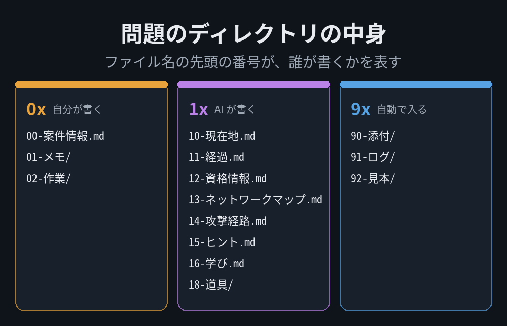
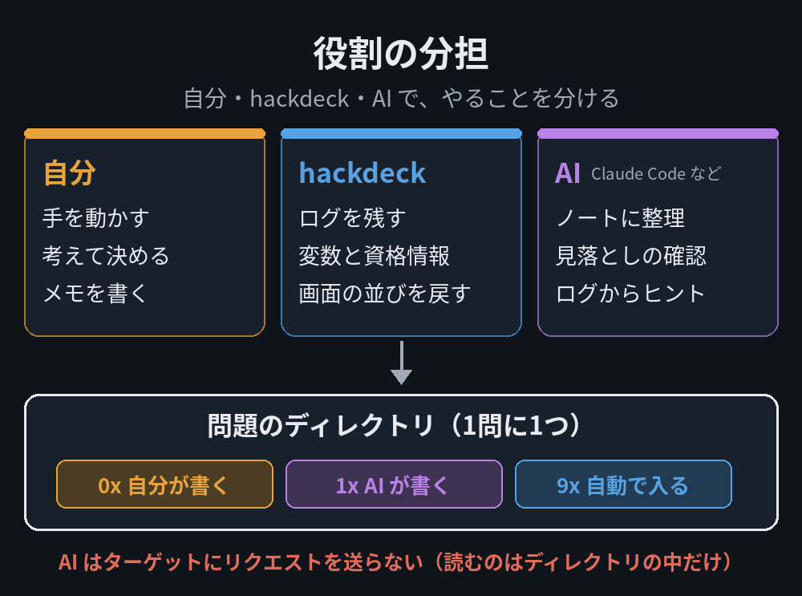

# Hacking-Op-public

HTB や CTF の問題を、1問ずつ整理するためのフォルダの雛形です。

問題ごとにこの雛形を clone して、その中に、自分のメモ・作業の結果・端末のログ・AI が書くノートを入れていきます。ファイル名の先頭の番号で、誰が書くかを分けているのが特徴です。



> [!WARNING]
> **作者が、自分の学習のためだけに作り込んだ雛形です。** 日本語だけで、Obsidian と Claude Code で読み書きする前提です。
> そのまま使うより、考え方の参考にしてもらうための公開です。

## 誰が書くか

| 番号 | 誰が書く | 中身 |
|---|---|---|
| `0x` | 自分 | メモ（`01-メモ/`）と、作業用のフォルダ（`02-作業/`）。範囲（スコープ）が決まっている問題なら `00-案件情報.md` |
| `1x` | AI | いまの状況・やったこと・資格情報の表・ネットワークの図・うまくいった手順・ヒント・学び |
| `9x` | 自動 | 貼った画像（`90-添付/`）と、端末で打ったコマンドと出力のログ（`91-ログ/`） |

自分が書くのは、ほぼメモだけです。見出しも順番も気にせず、思いついたことを書き足します。

<details>
<summary>ファイルの一覧</summary>

| ファイル | 誰が書く | 中身 |
|---|---|---|
| `00-案件情報.md` | 自分 | 範囲（スコープ）。決まっている問題のときだけ |
| `01-メモ/` | 自分 | 思いついたこと。見出しも順番も要らない |
| `02-作業/` | 自分 | 作業用のフォルダ。道具の出力もここに |
| `10-現在地.md` | AI | いま分かっていることと、次の一手 |
| `11-経過.md` | AI | やったこと・うまくいかなかった手・まだ追っていない手がかり |
| `12-資格情報.md` | AI | 資格情報とサービスの表（まだ試していない組み合わせが分かる） |
| `13-ネットワークマップ.md` | AI | ホストと、どこからどこへ届くか（図） |
| `14-攻撃経路.md` | AI | うまくいった手順だけを、時系列で |
| `15-ヒント.md` | AI | 出したヒントの履歴 |
| `16-学び.md` | AI | 次の問題でも使えそうなこと |
| `18-道具/` | AI | 頼んで作ってもらった使い捨てのスクリプト |
| `90-添付/` | 自動 | 貼った画像 |
| `91-ログ/` | 自動 | 端末で打ったコマンドと出力 |
| `92-見本/` | 自動 | 書き方の見本 |

</details>

## AI が書く部分

このフォルダを Claude Code などで開いて、次のように頼みます。AI への決まりは、フォルダの中の `CLAUDE.md` に書いてあります。

- 「整理して」… ログとメモから、`1x` のノートを事実だけで埋める（ログの何行目か、出どころつき）
- 「見落としは？」… 出ていたのに追っていない手がかりを洗い出す
- 「ヒント」… ここまでのログとメモだけから、弱いヒントを1つ。「もっと」と言うまで先に進まない
- 「学びをまとめて」… 次の問題でも使えそうなことを下書きする

AI はターゲットにリクエストを送らず、このフォルダの中のファイルだけを読みます。作者は、この頼み方を Claude Code のスキルにまとめて使っています（スキルは公開していません）。

## 使い方

**hackdeck と使う**: [hackdeck](https://github.com/Ch4n24n/hackdeck-public) で問題を作ると、既定でこの雛形を clone し、そのフォルダで tmux のセッションが始まります。端末で打ったコマンドと出力は、`91-ログ/` に自動で残ります。

**単独で使う**: 問題ごとに clone して、Obsidian で開きます（端末のログは、自分で `91-ログ/` に残します）。

```bash
git clone https://github.com/Ch4n24n/Hacking-Op-public.git ~/cases/<問題の名前>
```

`.gitignore` は、記録として残すもの以外を全部無視する形にしてあります（作業用のフォルダには、落としたファイル・鍵・VPN の設定などが入るため）。

## 考え方



手を動かして考えるのは自分、覚えておくだけの仕事は hackdeck、面倒な整理と見落としの確認は AI、という分け方です。学習が目的なので、問題を解く部分は AI に任せません。詳しい考え方は、作者のブログ（https://ch4n24n.github.io/）に書いています。

## ライセンス

MIT（[LICENSE](../LICENSE)）
